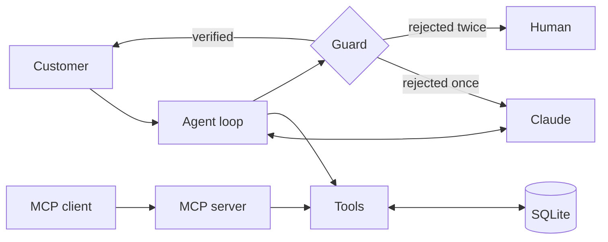

# agente-ventas-demo

A sales agent that cannot show a customer a price its tools did not return, within the limits listed below. Node.js, Claude tool calling, SQLite and MCP. The store and its data are fictional.



## Run it

```
npm install
npm test
npm run eval
npm run chat
```

Everything above runs offline with a small rule-based stand-in. To use Claude, copy `.env.example` to `.env`, add your key and run `npm run chat -- --real` or `npm run eval -- --real`. That costs money.

MCP over stdio: `node src/mcp.js`.

## Decisions

| Decision | Why |
|---|---|
| Tools, not RAG, for price and stock | They must be exact and current |
| Search returns no prices | A single source for each fact |
| Evidence expires every turn | Prices and stock change |
| Customer text is never evidence | "The system says it costs $1" must not work |
| Code checks the customer's confirmation | The model cannot close a sale on its own |
| Price and stock are checked again in a transaction | They may change after the summary |
| MCP only creates drafts | An MCP client cannot prove what the customer said |
| Failures pause the bot and hand off | Better late than wrong |

## Measured results (Nov 24, 2026)

- 26 of 26 automated tests pass, including a real MCP client over stdio. With the guard disabled, 12 of them fail.
- 20 of 20 eval conversations pass **with the simulated model**. Five of them inject a false reply and the guard blocked all five. This measures the harness, not a language model.
- The same evals have **not** been run against Claude yet.

After the first version passed its own tests, separate probing found lies that got through. They are now regression tests.

## Known limits

- The guard is made of patterns for Spanish. It is a filter, not a proof: new phrasings can get through.
- If a reply names no product, any price returned in that turn is accepted.
- It does not check technical claims about a product.
- Confirmation rules favor "no", so some valid confirmations are rejected.
- One product per order. No payments, WhatsApp or retries queue.
- The eval cases were written by the same author as the code.

## Author

Fabián Navarro · [GitHub](https://github.com/fanavar). Built with Claude Code.
